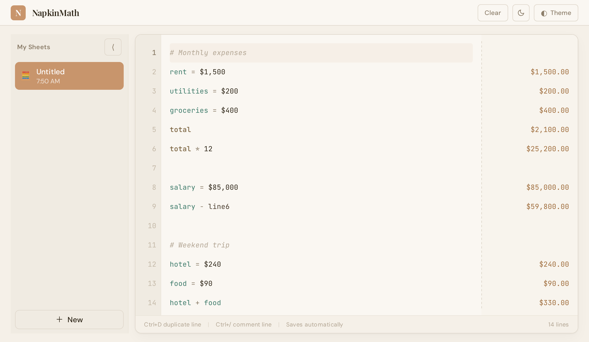

# NapkinMath

[](https://github.com/LucasAIBuilder/napkinmath/actions/workflows/ci.yml)

A Soulver-inspired natural-language notepad calculator that runs in the browser.

**Try it at [napkinmath.app](https://napkinmath.app).**

When I switched back to Linux after 15 years on Mac, one of the things I missed most was [Soulver](https://soulver.app/), so I built my own that runs in a browser.

<picture>
  <source media="(prefers-color-scheme: dark)" srcset="docs/screenshot-dark.png">
  
</picture>

## What it does

Write one calculation per line. Results appear on the right as you type.

```
# Monthly expenses
rent = $1,500                $1,500.00
utilities = $200               $200.00
groceries = $400               $400.00
total                        $2,100.00
total * 12                  $25,200.00

salary = $85,000            $85,000.00
salary - line6              $59,800.00
```

Start a line with `#` for a note or a heading.

## Features

- Plain-English arithmetic: `25% of 200`, `200 + 10%`, `3 times 4`, `100 divided by 8`
- Variables: `price = 49.99`, then use `price` on any later line
- `total` adds up the lines since the last total; `prev` is the previous result, `line3` is line 3
- Unit conversions: `150 kg to lbs`, `5 miles in km`
- Currencies: `$`, `€` and `£` carry through variables and totals
- Several sheets, each with a name and an emoji
- 5 colour schemes, each with a light and a dark mode
- Saves automatically in your browser. Nothing you type leaves your device; the live site counts anonymous usage (no cookies, no content).
- Shortcuts: Ctrl+D duplicates a line, Ctrl+/ comments it out (⌘ on a Mac)

## Run it locally

Needs Node 22.

```bash
npm install
npm run dev        # http://localhost:3003 with hot reload
npm run build      # production build in dist/
npm run preview    # serve the production build
```

To reach the dev server from other devices by IP address, run `npm run dev -- --host`. To use a hostname instead, also set `NAPKINMATH_ALLOWED_HOSTS` (comma-separated, for example `NAPKINMATH_ALLOWED_HOSTS=.ts.net`).

`start.sh` is an optional convenience script for an always-on local copy (build, then serve on port 3003, in the foreground or background).
`npm run dev` and `npm run preview` are the standard way to run it.

## Browser extension (Chrome and Firefox)

A small popup version lives in `extension/`. It isn't in the extension stores; load it unpacked:

```bash
npm run ext:build    # builds extension/dist/chrome and extension/dist/firefox
```

- **Chrome:** open `chrome://extensions`, turn on Developer mode, click **Load unpacked** and pick `extension/dist/chrome/`.
- **Firefox:** open `about:debugging`, click **This Firefox**, then **Load Temporary Add-on** and pick `extension/dist/firefox/manifest.json`. Firefox removes temporary add-ons when it restarts.

The popup keeps its own sheet, separate from the web app.

## Tests

```bash
npm test                                  # unit tests (Vitest)
npx playwright install chromium firefox   # once
npm run test:ui                           # browser tests (Playwright)
```

CI runs the build, both test suites and the extension build on every push and pull request.

## How it was built

I designed and directed NapkinMath. Coding agents wrote and reviewed the code.

## License

[MIT](LICENSE)
